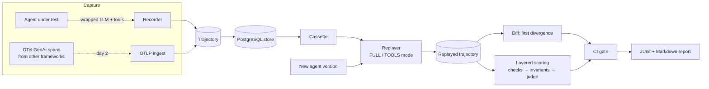

# Agent Replay

**Record, replay and regression-gate AI agent trajectories.**

> Status: 🚧 in progress (day 1 of 7). See [docs/PLAN.md](docs/PLAN.md) and
> [docs/PROGRESS.md](docs/PROGRESS.md).

## The problem

Agents fail across multi-step tool chains, not single prompts. A prompt tweak, a model upgrade
or a changed tool description can make an agent skip a lookup, loop, call a write tool with
drifted arguments, or burn twice the tokens, while single-turn evals stay green. Testing this
against live tools is slow, flaky and unsafe: you can't re-issue a refund every time CI runs.

Agent Replay records what an agent did as a typed *trajectory* (every model call and tool call),
then replays new agent versions against the **recorded world**: tool results come from a
cassette, so runs are deterministic, free and side-effect-safe. Trajectories are diffed to the
first divergence, scored in layers, and a CI gate fails the build on regressions.

## Architecture (target)



Solid lines exist today; dotted lines are planned (see the plan).

## What works today

- **Trajectory model** (`model.py`): pydantic v2, frozen, mirrors the OpenTelemetry GenAI
  `invoke_agent` → `chat` / `execute_tool` span shape; content fingerprints that ignore IDs,
  timestamps and durations.
- **Provider interface** (`providers/`): an async `LLMProvider` protocol, a deterministic
  `FakeLLM` driven by a pure policy function, and `ResilientLLM` (per-attempt timeout, bounded
  retries with full-jitter exponential backoff, fail-fast on non-retryable errors).
- **Recorder** (`recorder.py`): wraps any agent's provider and tool executor, emits OTel GenAI
  spans with token and cost attributes, and returns a `Trajectory`, also for failed runs.
- **Replayer** (`replay.py`): content-addressed cassette (canonical request → response, FIFO for
  repeats), `FULL` and `TOOLS` modes, strict matching that fails at the exact divergence point,
  and no real tool is executed during replay.
- **Reference agent** (`reference/support_desk.py`): a support-desk agent with a read tool and a
  side-effecting refund tool, plus a seeded regression policy.
- **Cost accounting**: deterministic token estimation for the fake provider and a configurable
  price table.

## Quick start

```bash
cd projects/01-agent-replay
uv venv -p 3.12 && uv pip install -e '.[dev]'   # or: python -m venv .venv && pip install -e '.[dev]'

# Record a run of the reference agent
agent-replay record --task "I'd like a refund for ORD-1001, it arrived damaged." --out run.json

# Replay it unchanged: identical, exit 0
agent-replay replay run.json --mode full

# Replay a regressed agent version against the recorded tools: diverges, exit 1
agent-replay replay run.json --mode tools --policy skip-lookup

# Record and replay every sample task
agent-replay demo
```

No API keys are needed; the default provider is the deterministic fake.

## Development

```bash
ruff check . && ruff format --check .
mypy
pytest
```

## Security notes (initial)

- Replay never executes real tools; side-effecting tools (`side_effect=True`) are flagged in the
  trajectory and on spans so later scoring can treat any new write as unsafe.
- Recorded trajectories contain full prompts and tool outputs. Treat stored recordings with the
  same data classification as the production data they came from; redaction at ingest is planned.
- Recorded tool outputs are untrusted input to the agent under test (they may contain prompt
  injection captured from the real world); replay reproduces them faithfully on purpose.

## Results

Evaluation results will be added on day 7, with measured numbers only.

## License

MIT, see the [repository license](../../LICENSE).
